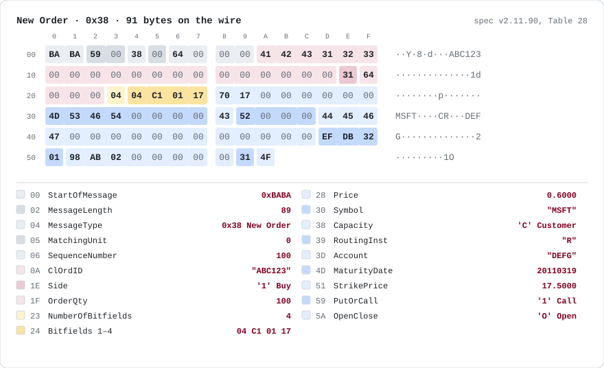

# TitaniumBOE-Sim

**A Cboe Titanium BOE exchange you can run on your laptop.** It speaks the binary order-entry protocol of
Cboe's U.S. options markets byte for byte (spec v2.11.90, 27 message types) and backs it with a
price-time matching engine, trading bots, RocksDB persistence, a REST API and a WebSocket feed, all in
one JAR.

[](https://github.com/YmidOrtega/TitaniumBOE-Sim/actions)
[](https://github.com/YmidOrtega/TitaniumBOE-Sim/actions)
[](LICENSE)

<picture>
  <source media="(prefers-color-scheme: dark)" srcset="docs/img/new-order-wire-dark.svg" />
  
</picture>

<sub>The New Order example from Table 28 of the spec, as the simulator decodes it. The bytes and every
decoded value are pinned by
[`NewOrderMessageTest.specTable28Example_parsesEveryField`](src/test/java/com/boe/simulator/protocol/message/NewOrderMessageTest.java).</sub>

> Educational and development use only. It does not connect to Cboe.

## Measured, not claimed

| | Result | Target |
|---|---|---|
| Order Ack P99 (900 orders, 10 BOE sessions, all acknowledged) | 2.5–4.1 ms | < 5 ms |
| Concurrent BOE TCP sessions, one virtual thread each | 500, none refused | ≥ 500 |
| REST throughput, public endpoints | 4,470–4,700 req/s | ≥ 800 req/s |
| BOE logins | 50–56/s | ≥ 200/s ❌ BCrypt cost 12, on purpose |

Four runs on a 16-core machine against a freshly started server (2026-10-08 and 2026-10-21). The
failing row stays in the table: password hashing is meant to be slow. How to reproduce it is under
[Load test](#load-test).

## Run it

Java 21 and Maven 3.9:

```bash
git clone https://github.com/YmidOrtega/TitaniumBOE-Sim.git
cd TitaniumBOE-Sim
mvn clean package -DskipTests
DEMO_MODE=true java -jar target/boe-simulator-*.jar
```

Or with Docker, no local JDK needed: `docker compose up --build`.

| Interface | Address |
|---|---|
| BOE binary protocol | `localhost:8081` |
| REST API | http://localhost:9091/api |
| Interactive API docs (Scalar) | http://localhost:9091/api/docs |
| WebSocket feed | ws://localhost:9091/ws/feed |

Demo accounts: `TRD1` / `Pass1234` and `TRD2` / `Pass5678`.

```bash
curl http://localhost:9091/api/health
curl http://localhost:9091/api/symbols/AAPL
curl -u TRD1:Pass1234 http://localhost:9091/api/positions
```

## What it implements

- **The BOE protocol, audited against spec v2.11.90.** 7 session and 20 application messages with the exact
  wire format, input and return bitfields, sequencing and replay. The spec's own hex examples are wire-format
  tests.
- **Matching engine.** Price-time priority; Day, IOC, FOK, GTC and GTD; reserve, MinQty and stop orders;
  self-trade prevention (MTP). Concurrency through a `StampedLock` with optimistic reads.
- **Risk controls.** Mass cancel, Purge Orders, self-imposed lockouts and Reset Risk.
- **Flow control from the spec.** TCP backpressure at 1,024 / 960 unacknowledged messages, and a per-session
  open-order limit of 2,000: the spec's 200,000 divided by 100 so it can be reached on a PC.
- **Persistence.** Users, orders and trades go to RocksDB through an async write-behind queue; after a
  restart, live orders go back into the book.
- **Trading bots.** Market maker, trend follower and random trader, to keep the book moving.
- **REST API and WebSocket feed**, with BCrypt-hashed credentials and rate limiting.

**Not implemented:** auctions, complex orders, crosses and market-maker quotes (answered with the spec's
rejects), and option series symbology: the book trades symbols like AAPL.

```
 BOE client ──TCP:8081──►  Session layer ──►  Matching engine ──►  RocksDB
 (binary)                  login, sequencing,  StampedLock          async
                           replay, backpressure      ▲
                                                     │
 Browser / REST client ──HTTP:9091──►  REST + WebSocket ◄── Trading bots
```

The full design is in [`docs/ARCHITECTURE.md`](docs/ARCHITECTURE.md).

## Configuration

Environment variables, via `.env` or `docker compose`:

| Variable | Default | Description |
|---|---|---|
| `DEMO_MODE` | `true` | Shown in the startup banner; demo users are seeded whenever the user store is empty |
| `BOE_PORT` | `8081` | BOE binary protocol port |
| `API_PORT` | `9091` | REST API port (`PORT` wins if the platform injects it) |
| `ALLOWED_ORIGINS` | localhost dev servers | Comma-separated CORS origins |
| `DEMO_USER_1` / `DEMO_PASS_1` | `TRD1` / `Pass1234` | First demo account (username max 4 chars) |
| `DEMO_USER_2` / `DEMO_PASS_2` | `TRD2` / `Pass5678` | Second demo account |
| `DEMO_ADMIN` / `DEMO_ADMIN_PASS` | `ADMN` / `Admin999` | Demo admin account |

Usernames and passwords must be alphanumeric (the BOE Login Request defines them as Alphanumeric). Users
seeded by an older version with `Pass1234!`-style passwords cannot log in over BOE: delete the RocksDB
directory to reseed them, or register new ones.

The RocksDB directory is a JVM system property, not an environment variable:
`java -Dcboe.db.path=/var/lib/boe/db -jar boe-simulator.jar` (default `./data/cboe_server`).

Everything runs from one container, so any host that builds a `Dockerfile` can run it (Railway, Render,
Fly.io, a VPS with `docker compose up -d --build`). Expose port 9091 for the API, and 8081 if BOE clients
connect from outside.

## Testing

```bash
mvn test                              # 606 tests
mvn clean test jacoco:report          # with coverage
mvn test -Dtest=MatchingEngineTest    # one class
```

### Load test

`LoadTestRunner` runs against a server that is already up and checks the targets in the table above:

```bash
mvn test-compile
java -cp "target/test-classes:target/classes:$(mvn -q dependency:build-classpath \
    -DincludeScope=test -Dmdep.outputFile=/dev/stdout)" \
    com.boe.simulator.load.LoadTestRunner \
    --tcp=500 --logins=100 --rest=5000 --ack-sessions=10 --ack-orders=90
```

On a cold server, before the JIT warms up, the order-ack P99 is 7.2–13.9 ms. The memory phase measures the
client's heap, not the server's, so its result is not meaningful.

## Project layout

```
src/main/java/com/boe/simulator/
├── protocol/        BOE message definitions and serialization
├── server/
│   ├── connection/  TCP sessions, login, sequencing, replay
│   ├── matching/    Matching engine
│   ├── order/       Order management
│   ├── risk/        Lockouts and risk resets
│   ├── auth/        Authentication (BCrypt)
│   └── persistence/ RocksDB repositories
├── bot/             Trading bots
└── api/             REST API, WebSocket, OpenAPI docs
```

## Documentation

| Document | Content |
|---|---|
| [`docs/ARCHITECTURE.md`](docs/ARCHITECTURE.md) | Architecture, matching engine, protocol layer and design decisions |
| [`docs/API_DOCUMENTATION.md`](docs/API_DOCUMENTATION.md) | REST API and WebSocket |
| [`docs/BOE Protocol Specification - Quick Reference.md`](<docs/BOE Protocol Specification - Quick Reference.md>) | BOE message reference, every difference from the spec with its fix, and the spec errata found |
| [`SECURITY.md`](SECURITY.md) | Security policy and known unpatched advisories |
| [DeepWiki](https://deepwiki.com/YmidOrtega/TitaniumBOE-Sim/1-overview) | Generated walkthrough of the codebase |

Interactive API docs while the server runs: Scalar at `/api/docs`, Swagger UI at `/api/swagger`, the OpenAPI
JSON at `/openapi`.

## License

MIT. See [LICENSE](LICENSE).

---

<div align="center">

**Built with ☕ Java and 📈 Financial Engineering**

**by [Ymid Ortega](https://github.com/YmidOrtega)**

[](https://github.com/YmidOrtega)
[](https://linkedin.com/in/ymidortega)

*If you found this project useful, consider giving it a ⭐!*

</div>
